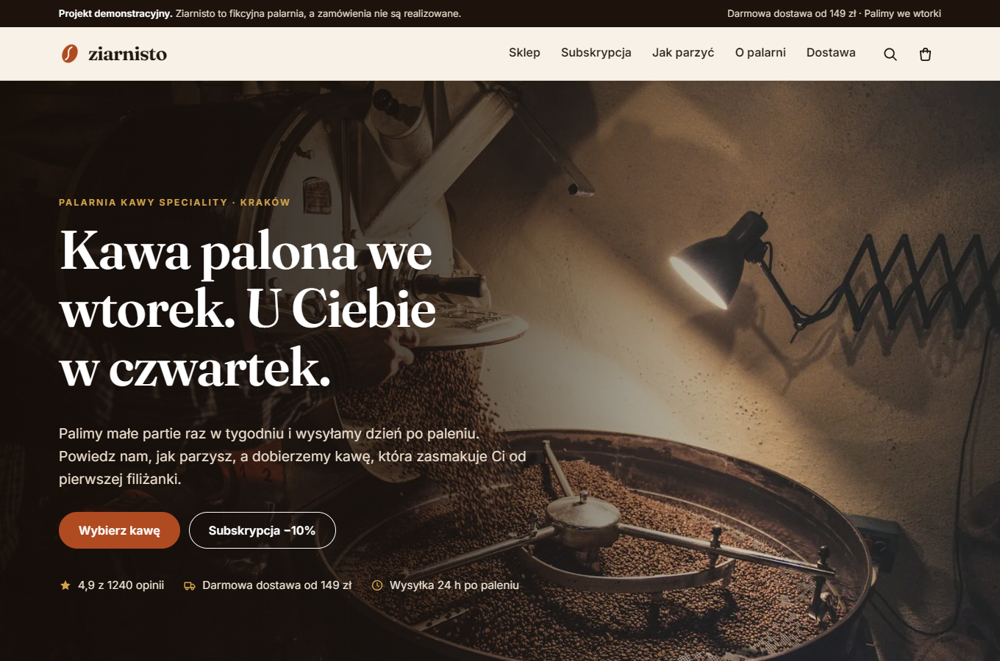

# Sklep palarni kawy

Sklep internetowy palarni kawy: strona główna, lista kaw z filtrami, karta kawy z subskrypcją, koszyk i zamówienie.

To projekt demonstracyjny. Palarnia Ziarnisto, jej kawy, ceny i opinie są fikcyjne, a zamówienia nie są realizowane ani opłacane.

**Demo:** [kocpeel.github.io/palarnia-kawy](https://kocpeel.github.io/palarnia-kawy/)



## Co potrafi

- Lista kaw z filtrami po metodzie parzenia, stopniu palenia i kraju, z wyszukiwarką i sortowaniem. Filtry zapisują się w adresie strony, więc wynik można wysłać linkiem.
- Karta kawy z wyborem opakowania, mielenia i subskrypcji co 2 albo co 4 tygodnie z rabatem 10%.
- Koszyk zapisany w przeglądarce: zmiana ilości, kod rabatowy, darmowa dostawa od 149 zł i w każdej subskrypcji, paczkomat, kurier albo odbiór osobisty.
- Formularz zamówienia, który sprawdza dane i podpowiada, co poprawić. Przycisk ma treść „Zamawiam z obowiązkiem zapłaty”, wymaganą przez prawo konsumenckie.
- Przy każdej obniżce najniższa cena z 30 dni przed promocją, zgodnie z dyrektywą Omnibus.
- Opakowania kaw rysowane w kodzie jako SVG, więc każdy nowy produkt od razu ma spójne zdjęcie.
- Widok na telefonie, obsługa z klawiatury i opisy dla czytników ekranu.

## Technologie

| Warstwa | Narzędzia |
|---|---|
| Strona | HTML, CSS i JavaScript w modułach, bez frameworka |
| Budowanie | Własny skrypt w Node.js bez zależności: wspólny szablon, nagłówek i stopka |
| Testy | `node:test` dla logiki koszyka, Playwright w Microsoft Edge dla całej ścieżki zakupu |
| Hosting | GitHub Pages, publikacja przez GitHub Actions |

Czcionki Fraunces i Inter są hostowane razem ze stroną, więc przeglądarka klienta nie łączy się z serwerami Google.

## Uruchomienie

Potrzebny jest Node.js 22 lub nowszy. Budowanie nie wymaga instalowania pakietów.

```powershell
npm run build
npm start
```

Strona działa wtedy pod adresem <http://localhost:4173>.

## Testy

```powershell
npm test
npm install
npm run e2e
```

- `npm test` sprawdza koszyk: ceny promocyjne i subskrypcje, kod rabatowy, darmową dostawę i formularz zamówienia.
- `npm run e2e` przechodzi w zainstalowanym Microsoft Edge drogę od strony głównej do złożonego zamówienia, sprawdza widok na telefonie i zapisuje zrzuty ekranu w `docs/`.

Na GitHubie testy uruchamiają się przy każdym wypchnięciu kodu, a strona publikuje się potem na GitHub Pages.

## Struktura

```text
src/pages/       treść podstron
src/partials/    nagłówek, stopka i inne wspólne fragmenty
src/assets/js/   koszyk, filtry, karta kawy i dane produktów
src/assets/css/  wygląd
scripts/         budowanie i lokalny serwer
tests/           testy logiki
e2e/             test w przeglądarce
docs/            zrzuty ekranu
```

## Zdjęcia

Zdjęcia pochodzą z serwisu Unsplash i są używane zgodnie z licencją Unsplash. Lista z linkami jest na stronie [Dostawa i informacje](https://kocpeel.github.io/palarnia-kawy/informacje.html#projekt).
